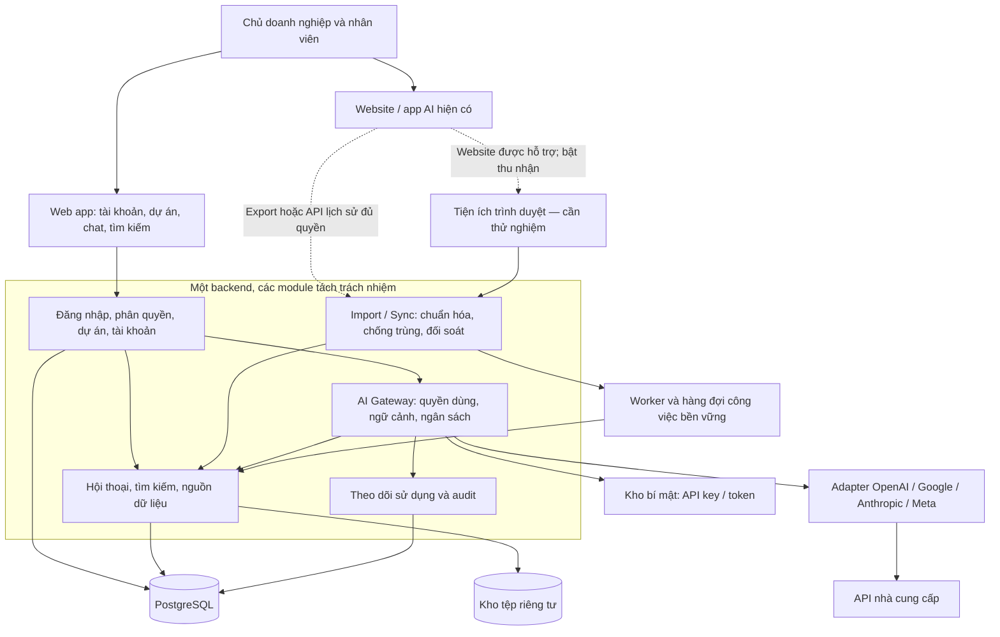

# Nex AI Hub — Phân tích yêu cầu và kiến trúc v0.1

> Bản lịch sử. [Bản v0.2](architecture-v0.2.md) cập nhật yêu cầu đã xác nhận: 5 nhân viên, một tài khoản mỗi nền tảng do chủ doanh nghiệp quản lý, nhân viên chỉ đăng nhập Hub. Những giả định về seat hoặc tài khoản nhà cung cấp riêng của nhân viên trong bản này không thuộc MVP hiện tại.

Ngày: 02/11/2026, múi giờ Việt Nam. Trạng thái: **Đề xuất để thảo luận**, chưa phải thiết kế đã được chủ sản phẩm chấp thuận. Áp dụng skill `architecture-designer`.

## 1. Kết luận thiết kế

Xây dựng một không gian làm việc AI nội bộ cho chủ doanh nghiệp và nhân viên, tổ chức theo dự án. Hệ thống quản lý tài khoản/gói thuê bao hiện có, kết nối API và lưu hội thoại tập trung.

Người dùng đã xác nhận cần **cả hai cách làm việc**: chat trực tiếp trong Hub và tiếp tục dùng website/app của nhà cung cấp rồi gom dữ liệu về Hub. Đồng thời cần quản lý cả gói thuê bao lẫn kết nối API.

Kiến trúc đề xuất: **web app + backend chia module trong cùng ứng dụng + PostgreSQL + kho tệp + worker nền**. Các kết nối được chia thành hai nhóm độc lập: gọi AI và thu nhận lịch sử. Tiện ích trình duyệt là phương án bổ sung cần thử nghiệm; chưa cam kết tự động thu toàn bộ hội thoại từ mọi website/app.

Hội thoại trong Hub có thể tự lưu đầy đủ trong phạm vi dữ liệu ứng dụng thực sự nhận được. Lịch sử bên ngoài chỉ thu nhận được theo quyền truy cập và khả năng của từng nguồn. Việc gọi được model qua API không chứng minh có thể đọc lịch sử từ tài khoản người dùng trên website/app.

## 2. Từ yêu cầu high level đến phạm vi hệ thống

| ID | Nhu cầu đã xác nhận | Chuyển thành yêu cầu sản phẩm | Thành phần chịu trách nhiệm |
|---|---|---|---|
| R01 | Giảm chuyển qua lại giữa nhiều AI | Một giao diện chat, chọn nhà cung cấp/model; điểm truy cập tài khoản hiện có | Giao diện Hub, AI Gateway, danh mục tài khoản |
| R02 | Chủ doanh nghiệp và nhân viên cùng dùng | Đăng nhập riêng, mời/khóa nhân viên, phân quyền | Workspace & Identity |
| R03 | Nhân viên có dự án riêng | Tạo dự án, sở hữu dự án, thêm thành viên, phân quyền đọc/sửa | Projects |
| R04 | Quản lý tài khoản và gói trả phí | Ghi nhận nhà cung cấp, chủ tài khoản, gói, seat, chi phí, ngày gia hạn | Account & Subscription Registry |
| R05 | Quản lý kết nối API | Cất giữ khóa, kiểm tra kết nối, cấp quyền sử dụng, hạn mức | Connections, Secrets, Usage |
| R06 | Lưu dữ liệu trao đổi tập trung | Lưu câu hỏi, câu trả lời, nguồn, thời gian, tệp và trích dẫn nhận được | Conversation Archive |
| R07 | Dùng cả ứng dụng mới lẫn app/website hiện có | Hai đường thu dữ liệu; hiển thị độ đầy đủ và lần thu nhận gần nhất | AI Gateway, Import & Sync |
| R08 | ChatGPT, Gemini, Claude và Meta AI | Adapter riêng; danh sách khả năng và trạng thái theo tài khoản | Provider Adapters |

Các đề xuất bổ sung: tìm kiếm hội thoại, gắn nhãn, xuất dữ liệu, bàn giao dự án, báo cáo sử dụng, cảnh báo chi phí và nhật ký quản trị. Đây là đề xuất kiến trúc, chưa phải yêu cầu đã được người dùng xác nhận.

## 3. Những khái niệm cần tách riêng

| Khái niệm | Ý nghĩa | Ví dụ |
|---|---|---|
| Người dùng Hub | Người đăng nhập hệ thống nội bộ | Nhân viên A |
| Tài khoản nhà cung cấp | Danh tính/workspace ở dịch vụ bên ngoài | Tài khoản Claude của A |
| Gói thuê bao và seat | Quyền sử dụng sản phẩm, kỳ thanh toán, người được cấp seat | Gói nhóm, A là một thành viên |
| Kết nối API | Thông tin xác thực để backend gọi một dịch vụ | API key thuộc project của công ty |
| Kết nối thu nhận lịch sử | Cách đọc dữ liệu bên ngoài với phạm vi quyền cụ thể | File export, Compliance API, tiện ích trình duyệt |
| Dự án Hub | Đơn vị tổ chức dữ liệu và quyền truy cập trong Hub | Nghiên cứu thị trường tháng 11 |

Một tài khoản có thể liên quan nhiều seat/kết nối; có tài khoản chỉ được ghi vào danh mục mà chưa kết nối kỹ thuật. Cùng email không có nghĩa cùng quyền API hay cùng phạm vi dữ liệu.

Quản lý tài khoản ở giai đoạn đầu là **quản lý danh mục, trách nhiệm, phân bổ và trạng thái**. Thay đổi seat, hủy gói hoặc gia hạn trên hệ thống bên ngoài chỉ tự động hóa khi có API quản trị phù hợp. Nếu nhập thủ công, phải hiển thị ngày kiểm tra và trạng thái “chưa xác minh”; không thể hiện như dữ liệu trực tiếp từ nhà cung cấp.

## 4. Khả năng tích hợp đã kiểm tra

Kiểm tra tài liệu chính thức ngày 02/11/2026. Đây là đánh giá tài liệu, chưa thử nghiệm tài khoản thực tế.

| Nền tảng | Chat trong Hub | Lấy hội thoại từ sản phẩm hiện có | Hệ quả thiết kế |
|---|---|---|---|
| ChatGPT / OpenAI | OpenAI API cung cấp cơ chế hội thoại cho ứng dụng [S1] | Export cho tài khoản đủ điều kiện; Enterprise/Edu có Compliance Platform theo quyền và cấu hình [S2][S3] | Adapter API và adapter lịch sử độc lập; chưa coi tài khoản cá nhân có API đồng bộ toàn bộ chat |
| Gemini / Google | Gemini API hỗ trợ tạo nội dung/hội thoại [S4] | Google hướng dẫn tải Gemini Apps Activity qua Takeout [S5] | Ưu tiên importer; cần mẫu export để biết dữ liệu thực tế, chưa xác nhận API phổ thông để đồng bộ toàn bộ lịch sử app |
| Claude / Anthropic | Claude API có Messages [S6] | Export tùy gói/quyền; nội dung chat tổ chức có thể lấy qua Compliance API trong phạm vi đủ điều kiện [S7][S8] | Không đồng nhất API key gọi model với khóa/quyền đọc dữ liệu tổ chức |
| Meta AI / Meta | Có tài liệu Meta Model API [S9] | Chưa xác minh được trong đợt nghiên cứu này một API phổ thông đọc toàn bộ lịch sử Meta AI cá nhân | Kiểm tra quyền API thực tế; trước mắt lưu nội dung người dùng cung cấp. Khả năng thu nhận từ website cần thử nghiệm riêng |

Meta AI có nhiều bề mặt sử dụng như website, app và các ứng dụng nhắn tin [S10]. Cần biết người dùng đang dùng bề mặt nào trước khi xác định độ bao phủ. Tích hợp model Meta qua API không mặc nhiên tái tạo toàn bộ trải nghiệm Meta AI hay thay thế bằng Llama rồi coi là cùng sản phẩm.

OpenAI quản lý billing ChatGPT và API riêng; tài liệu hiện tại cũng mô tả API credits cho một số thuê bao đủ điều kiện [S11][S12]. Claude cũng tách API billing, dù một số gói có credits [S13]. Gemini API quản lý billing theo Cloud Billing/project [S14]. Vì vậy phải lưu riêng **chi phí thuê bao, usage API, credits và số tiền thực thanh toán**; không suy ra quyền API từ tên gói.

Tính năng tìm kiếm web, đọc tệp, tạo ảnh, bộ nhớ và công cụ có thể khác giữa website/app và API. Adapter phải công bố khả năng thực tế; chưa hỗ trợ thì giao diện thể hiện rõ. Đối với tìm thông tin mới, cần kiểm chứng search/grounding và lưu trích dẫn, không mặc định mọi câu trả lời đều được tra cứu web.

## 5. Chiến lược gom dữ liệu

| Đường dữ liệu | Cam kết có thể đặt ra | Giới hạn cần thể hiện |
|---|---|---|
| Chat tạo trong Hub | Lưu prompt trước khi gọi API; lưu nội dung và trạng thái phản hồi nhận được | Dữ liệu từ chối lưu phải báo lỗi; phản hồi dở dang không đánh dấu hoàn tất |
| API đọc lịch sử được cấp quyền | Thu định kỳ theo cursor/watermark, lưu thời điểm và phạm vi | Phụ thuộc gói, quyền, độ trễ, retention và loại nội dung được cung cấp |
| Nhập file export | Nhập dữ liệu có trong file, xem trước, chọn dự án, báo thiếu/trùng | Là bản chụp tại thời điểm xuất; có thể thiếu tệp/nhánh/metadata |
| Tiện ích trình duyệt | Thu nội dung trang mà người dùng bật và tiện ích quan sát được | Cần thử nghiệm từng website; không bao phủ mặc nhiên app mobile/native hay tin nhắn chưa tải |
| Nhập thủ công | Lưu văn bản/tệp được chọn và đường dẫn nguồn nếu có | Không tự xác minh tính đầy đủ, tài khoản nguồn hoặc thời gian gốc |

Đề xuất phiên bản đầu: **thu một chiều từ nguồn ngoài về Hub**. Không đồng bộ chỉnh sửa, xóa hoặc phản hồi từ Hub ngược về các website. Đây phù hợp mục tiêu “gom về một chỗ” và giảm xung đột dữ liệu.

Khi tiếp tục một chat nhập từ bên ngoài bằng API trong Hub, tạo **nhánh hội thoại mới**, liên kết đến bản gốc và ghi nhà cung cấp mới. Người dùng xem/chọn phần ngữ cảnh được gửi. Không ngầm gửi toàn bộ dữ liệu dự án sang nhiều nhà cung cấp, và không tuyên bố đã tiếp tục cùng thread trên app nguồn.

Trạng thái thu nhận cần có: nguồn, lần cập nhật, phạm vi quan sát, `complete_for_scope / partial / unknown`, nội dung/tệp thiếu, parser version và lỗi. “Đầy đủ” chỉ có ý nghĩa trong phạm vi xác định; chưa biết tổng lịch sử thì không hiển thị 100%.

Tiện ích sử dụng khả năng content script đọc nội dung trang [S15]. Đây là cơ sở kỹ thuật cho thử nghiệm, không phải bằng chứng bốn nền tảng đều cho phép hoặc hỗ trợ cách tích hợp đó. Cần kiểm chứng luồng đăng nhập, dữ liệu trang và chính sách nhà cung cấp trước khi phát hành connector.

## 6. Kiến trúc tổng thể

Các mũi tên qua backend đều chịu kiểm tra quyền; sơ đồ không thể hiện chi tiết mọi bước xác thực. Đây là kiến trúc logic, không phải mỗi ô là một microservice.

| Module | Trách nhiệm chính |
|---|---|
| Workspace & Identity | Đăng nhập, mời người dùng, vai trò, khóa tài khoản, phiên đăng nhập |
| Projects | Thành viên, chủ dự án, quyền đọc/sửa, lưu trữ và bàn giao |
| Account & Subscription Registry | Tài khoản nguồn, gói, seat, ngày gia hạn, người phụ trách, mức độ xác minh |
| Provider Connections | Kết nối gọi model/đọc lịch sử, phạm vi quyền, trạng thái, tham chiếu secret |
| AI Gateway | Chọn adapter/model, kiểm tra quyền và ngân sách, xây ngữ cảnh, streaming |
| Conversation Archive | Cấu trúc tin nhắn thống nhất, nhánh, phiên bản, tệp, nguồn và tìm kiếm |
| Import & Sync | Nhập file, lịch thu nhận, cursor, chống trùng, báo thiếu, phục hồi job lỗi |
| Usage & Audit | Usage theo người/dự án/kết nối; nhật ký thay đổi quyền và cấu hình |

## 7. Các luồng nghiệp vụ chính

### 7.1 Đăng ký tài khoản và cấp quyền dùng

1. Quản trị thêm tài khoản nguồn, gói/seat và người phụ trách; chưa cần cung cấp mật khẩu.
2. Nếu có API, cấu hình kết nối riêng; backend kiểm tra quyền truy cập, model và quota thực tế.
3. Chỉ định người/nhóm được dùng kết nối và ngân sách.
4. Nhân viên đăng nhập Hub bằng danh tính riêng; không cần xem khóa API của công ty.

### 7.2 Nhân viên chat trong dự án

1. Nhân viên tạo/chọn dự án, chọn AI và gửi câu hỏi.
2. Backend kiểm tra quyền dự án, quyền dùng kết nối, khả năng model và ngân sách; lưu prompt cùng mã yêu cầu.
3. Đóng gói ngữ cảnh được phép, gọi adapter và truyền phản hồi về màn hình.
4. Lưu nội dung nhận được, nguồn, model, usage và trạng thái `complete / failed / interrupted / unknown`.
5. Người dùng tìm lại hoặc chuyển sang AI khác bằng một nhánh rõ ràng.

Ngân sách API giữ trước một phần dự toán theo giới hạn output, rồi đối soát usage nhận được. Với gọi đồng thời, cập nhật hạn mức trong giao dịch để tránh nhiều yêu cầu cùng vượt trần. Nếu nhà cung cấp không trả usage, đánh dấu ước tính/chưa biết thay vì tạo số liệu giả.

### 7.3 Gom lịch sử bên ngoài

1. Chọn nguồn và phạm vi được phép; tải file export, cấp API lịch sử hoặc bật connector trình duyệt đã hỗ trợ.
2. Đưa dữ liệu vào vùng tạm riêng tư, kiểm tra và hiển thị bản xem trước.
3. Người dùng gán hội thoại vào dự án; dữ liệu chưa gán nằm trong hộp thư nhập riêng của người thực hiện.
4. Chuẩn hóa và chống trùng; lưu bản gốc chọn lọc theo chính sách lưu trữ, thời gian nguồn và thời gian nhận.
5. Báo số bản ghi nhập thành công, trùng, lỗi, thiếu tệp và phạm vi chưa biết.

### 7.4 Nhân viên nghỉ việc / bàn giao

Khóa người dùng Hub, thu hồi phiên và quyền kết nối, bàn giao dự án công việc. Tác vụ thu hồi seat trên nhà cung cấp là bước riêng: tự động khi có API đủ quyền, nếu không tạo việc cho quản trị và theo dõi hoàn thành. Khóa trong Hub không được trình bày như đã khóa tài khoản bên ngoài.

## 8. Mô hình dữ liệu ở mức khái niệm

| Nhóm | Thực thể | Dữ liệu đáng chú ý |
|---|---|---|
| Tổ chức | Workspace, User, Membership | Danh tính và vai trò trong Hub |
| Dự án | Project, ProjectMember | Chủ dự án, quyền đọc/sửa, trạng thái |
| Tài khoản | ProviderAccount, Subscription, SeatAssignment | Nhà cung cấp, định danh nguồn, gói, chu kỳ, chi phí, `verified_at` |
| Tích hợp | Connection, CredentialRef, Capability | Loại kết nối, scopes, phạm vi được phép, trạng thái, khóa tham chiếu |
| Hội thoại | Conversation, Message, MessageRevision | Dự án, nguồn, vai trò, nhánh/parent, phiên bản, trạng thái |
| Nội dung | ContentBlock, Attachment, Citation | Text, ảnh, tệp, nguồn trích dẫn, metadata gốc |
| Thu nhận | ImportBatch, SyncCursor, SourceRecord | External ID, checksum, phạm vi, watermark, parser version |
| Chi phí | Run, UsageRecord, Budget, CreditRecord | Model, input/output, estimate/actual/unknown, bảng giá có hiệu lực |
| Quản trị | AuditEvent, RetentionPolicy | Ai thay đổi gì, lúc nào; thời gian giữ và xử lý xóa |

Trong Hub, một dự án có nhiều hội thoại; một hội thoại thuộc một dự án chính. Mỗi tin nhắn/lần chạy ghi nhà cung cấp và model riêng để hỗ trợ đổi AI giữa các lượt.

Nội dung được chuẩn hóa thành các khối; giữ metadata đặc thù trong JSONB và tệp lớn ở object storage. PostgreSQL có hỗ trợ JSONB và index [S16]. Các suy nghĩ nội bộ hoặc dữ liệu nhà cung cấp không trả về không nằm trong cam kết lưu trữ.

Chống trùng dựa trên workspace + danh tính tài khoản nguồn đã xác minh + external conversation/message ID khi có. Nếu thiếu ID đáng tin cậy, chỉ phát hiện bản giống nhau bằng fingerprint trong phạm vi nhập; không tự gộp các hội thoại chỉ vì cùng văn bản. Dữ liệu đến qua export và extension phải qua bước đối soát trước khi gộp xuyên nguồn.

Không ghi đè mất lịch sử sửa/nhánh. Việc tiếp tục lại một yêu cầu tạo Run mới liên kết Run trước. Thời gian nguồn, thời gian thu nhận và múi giờ là các trường riêng.

## 9. Quyền truy cập và bảo vệ dữ liệu

Đề xuất mặc định: dự án chỉ hiển thị với chủ dự án và thành viên được thêm. Quản trị hệ thống quản lý tài khoản, kết nối, metadata vận hành; quyền đọc nội dung dự án của người khác là quyền riêng cần chủ sản phẩm xác định. Không đồng nhất “admin” với mặc nhiên xem mọi hội thoại cá nhân.

Kiểm tra quyền tại backend cho cả tìm kiếm, tải tệp, xuất dữ liệu và job nền. Worker phải kiểm tra lại quyền khi thực thi, không chỉ lúc đưa job vào hàng đợi. Nội dung lấy từ bên ngoài không có quyền thay đổi chính sách hoặc ra lệnh cho hệ thống.

API key được giữ phía máy chủ trong kho bí mật; DB chỉ lưu tham chiếu. Không lưu mật khẩu/OTP/cookie đăng nhập website để phát cho nhân viên. Nếu bổ sung OAuth chính thức, lưu và thu hồi token theo phạm vi. Mọi liên kết tệp đều yêu cầu xác thực hoặc URL ký thời hạn ngắn.

Tài khoản cá nhân có thể trộn công việc và riêng tư: preview/chọn phạm vi nhập là bắt buộc trong thiết kế. Extension chỉ hoạt động với nguồn/phạm vi người dùng bật, báo trạng thái thu nhận rõ ràng, không mặc định thu toàn bộ duyệt web.

Làm sạch HTML/Markdown trước khi hiển thị; kiểm tra loại/kích thước tệp và archive; không chạy mã trong file import. Log vận hành mặc định không chứa prompt, câu trả lời hoặc secret. Kho dữ liệu, bản sao lưu và dữ liệu tạm áp dụng cùng phạm vi bảo vệ.

Xóa tại Hub chỉ xóa bản sao do Hub quản lý theo chính sách, không hứa xóa tại nhà cung cấp. Tombstone ngăn job cũ nhập lại dữ liệu đã xóa; bản sao lưu hết hạn theo retention. Nếu nguồn gửi sự kiện xóa, xử lý theo chính sách đã công bố, không âm thầm giữ như dữ liệu còn hoạt động.

## 10. Công nghệ và đánh đổi

Đây là lựa chọn đề xuất, cần điều chỉnh theo kỹ năng đội triển khai.

| Lớp | Đề xuất | Phương án so sánh / đánh đổi |
|---|---|---|
| Giao diện | Web responsive; React + TypeScript là ứng viên | Vue tương đương nếu đội quen; desktop tiện gom cửa sổ nhưng tăng công sức cập nhật và tích hợp |
| Backend | Modular monolith; Node.js/TypeScript là ứng viên | Python/FastAPI phù hợp đội Python; microservices tăng vận hành khi chưa có nhu cầu tách triển khai |
| Database | PostgreSQL, dữ liệu quan hệ + JSONB | MySQL vẫn khả thi; MongoDB linh hoạt nhưng các quan hệ quyền/seat/dự án cần thiết kế nhất quán |
| Tệp | Object storage riêng tư, mã hóa và backup | Lưu trên ổ máy app dễ bắt đầu nhưng làm khôi phục/scale phức tạp |
| Công việc nền | Worker cùng codebase; hàng đợi bền vững trên DB lúc đầu | Redis/queue chuyên dụng khi đo được nhu cầu; chưa cần thêm từ đầu |
| Tìm kiếm | Bộ lọc + index PostgreSQL; thử `pg_trgm` cho tiếng Việt [S17] | Search engine riêng khi chất lượng/độ trễ không đạt; vector search chưa cần cho tìm lịch sử thông thường |
| Đăng nhập | OIDC/SSO hoặc dịch vụ xác thực được quản lý | Tự xây toàn bộ xác thực làm tăng phần bảo trì; chọn theo hạ tầng công ty |
| Triển khai | Web/API, worker, DB được quản lý, kho tệp và secret trong một vùng phù hợp | Một VM có thể rẻ hơn nhưng tăng trách nhiệm backup/cập nhật; chưa chốt cloud/vendor |

Không chọn desktop wrapper làm điều kiện tiên quyết của MVP. Wrapper có thể gom cửa sổ nhưng không tự cung cấp quyền truy cập lịch sử hoặc bảo đảm đăng nhập được trên mọi nhà cung cấp. Nếu nghiên cứu Electron sau này, phải tách nội dung từ xa khỏi quyền hệ thống và duy trì cập nhật bảo mật [S18].

## 11. Yêu cầu phi chức năng và tình huống lỗi

Các con số dưới đây là **mục tiêu thử nghiệm đề xuất**, không phải ràng buộc người dùng đã đưa ra hay cam kết nhà cung cấp.

| Chủ đề | Mục tiêu/thiết kế ban đầu |
|---|---|
| Quy mô | Thử nghiệm 5–20 tài khoản, 5 lượt AI đồng thời; đo trước khi định cỡ chính thức |
| Hiệu năng Hub | p95 dưới 1 giây cho danh sách/tìm kiếm trên bộ dữ liệu pilot được thống nhất; tách thời gian AI ra khỏi chỉ số này |
| Độ bền dữ liệu | Chỉ báo “đã lưu” sau commit; lưu prompt trước API và checkpoint nội dung streaming nhận được |
| Backup | Đề xuất RPO 24 giờ, RTO 8 giờ cho pilot; phải thử khôi phục và điều chỉnh theo mức mất dữ liệu chấp nhận được |
| Khả dụng | Chưa chốt SLA; đo riêng API nội bộ, lưu trữ và từng nhà cung cấp AI |
| Quan sát | Theo dõi job lỗi, độ trễ đồng bộ, kết nối hết quyền, usage chưa đối soát, backup và truy cập bị từ chối |
| Mở rộng | Giới hạn đồng thời theo người/kết nối; tách worker khi import nặng, thêm search engine khi đo được nút thắt |

| Tình huống | Cách xử lý |
|---|---|
| Nhà cung cấp AI lỗi/hết quota | Giữ prompt và hội thoại; báo nguyên nhân; cho người dùng chọn thử lại/đổi AI. Không tự gửi sang nhà cung cấp khác |
| Timeout sau khi gửi yêu cầu | Đánh dấu chưa rõ kết quả; không retry mù vì có thể tính phí hai lần. Đối soát qua request ID nếu được hỗ trợ |
| Mất mạng khi đang nhận phản hồi | Lưu phần đã nhận, ghi interrupted; nối lại chỉ khi giao thức hỗ trợ, nếu không tạo lượt mới rõ ràng |
| File export lỗi/thay đổi định dạng | Cách ly batch, báo lỗi theo mục, giữ dữ liệu đã có; parser có version |
| Extension hỏng vì giao diện đổi | Dừng capture nguồn đó, hiển thị trạng thái thiếu; dùng import/thủ công, không báo đã đồng bộ |
| Trùng hoặc cập nhật sai thứ tự | Khóa duy nhất theo nguồn đáng tin, lưu revision, job idempotent, cursor chỉ tiến sau commit |
| Thu hồi quyền giữa lúc job chạy | Kiểm tra lại quyền; dừng job, hủy token cần thu hồi và ghi audit |
| DB/kho tệp gián đoạn | Không xác nhận lưu thành công; queue retry có giới hạn và đối soát tệp mồ côi |

Chi phí tổng gồm: hạ tầng + thuê bao/seat + API theo usage + lưu trữ/backup + bảo trì connector. Credits làm giảm số tiền thanh toán trong phạm vi áp dụng, không làm usage biến mất. Chưa ước tính tiền/thời gian vì chưa có số nhân viên, gói và khối lượng chat thực tế.

## 12. Lộ trình và tiêu chí nghiệm thu

| Giai đoạn | Sản phẩm bàn giao | Điều kiện hoàn thành |
|---|---|---|
| 0 — Kiểm chứng | Danh sách tài khoản/gói/bề mặt sử dụng; mẫu export đã chọn; ma trận khả năng thực tế | Biết rõ từng nguồn hỗ trợ chat, import, sync gì và thiếu gì; kiểm tra quyền API nếu có |
| 1 — Quản lý tài khoản và dự án | Đăng nhập riêng, quản lý gói/seat, kết nối, phân quyền, dự án, kho hội thoại và nhập thủ công | Chủ doanh nghiệp biết ai dùng gì; nhân viên tạo dự án và lưu/tìm nội dung trong đúng phạm vi |
| 2 — MVP làm việc trong Hub | Chat API, lưu tự động, tìm kiếm, importer nguồn đã xác minh, usage và giới hạn | Có ít nhất một luồng chat→lưu→tìm lại hoàn chỉnh; công bố chính xác hỗ trợ của cả bốn nhà cung cấp, không đánh dấu hoàn thành tích hợp khi chưa thử |
| 3 — Đồng bộ mở rộng | API lịch sử đủ điều kiện; thử nghiệm rồi phát hành extension theo từng nguồn | Có kiểm tra dữ liệu thiếu, sửa/nhánh/trùng, mất mạng, đổi tài khoản và thu hồi quyền |
| 4 — Khai thác tri thức | Tóm tắt dự án, kho prompt, so sánh AI, tìm kiếm ngữ nghĩa nếu cần | Chứng minh giá trị trên dữ liệu thật và bảo toàn quyền nguồn |

Giai đoạn 1 đáp ứng ưu tiên quản lý tài khoản, nhưng chưa giải quyết đầy đủ việc dùng nhiều AI trong một cửa sổ. Giai đoạn 2 giải quyết luồng dùng mới; giai đoạn 3 tăng mức tự động khi vẫn dùng sản phẩm bên ngoài. Chức năng nào chưa có connector đạt yêu cầu phải ghi rõ chưa hỗ trợ.

Các kiểm tra bắt buộc khi triển khai: A không đọc/tìm/xuất được dữ liệu dự án của B nếu chưa được cấp quyền; nhập cùng file không tạo bản trùng; đổi model lưu đúng nguồn; lỗi API không mất prompt; chi phí chưa biết được đánh dấu; khóa người dùng dừng quyền truy cập; khôi phục được backup. Đây là tiêu chí dự kiến, chưa có phần mềm để chạy kiểm thử.

## 13. Những điểm còn cần xác nhận

1. Có bao nhiêu nhân viên và họ dùng máy tính hay mobile là chính?
2. Các gói hiện có là cá nhân, nhóm hay Enterprise; công ty sở hữu hay nhân viên tự sở hữu? Chỉ cần tên gói/số lượng, không gửi mật khẩu hoặc API key trong chat.
3. Meta AI đang dùng qua meta.ai, app riêng, WhatsApp, Messenger hay Instagram?
4. Chủ doanh nghiệp có cần quyền xem tất cả dự án công việc, hay chỉ dự án được chia sẻ?
5. Ưu tiên trải nghiệm “một giao diện chat API” hay “giữ đầy đủ tính năng app gốc trong một nơi” khi hai mục tiêu xung đột?
6. Mức tự động đồng bộ tối thiểu chấp nhận được, thời gian giữ dữ liệu và ngân sách vận hành?

Những câu trả lời này sẽ điều chỉnh phạm vi và NFR; không cần bỏ lại mô hình lõi. Các quyết định hiện tại được lưu ở [decision-records.md](decision-records.md), tất cả ở trạng thái Proposed.

## 14. Nguồn chính thức

- [S1 — OpenAI: Conversation state](https://developers.openai.com/api/docs/guides/conversation-state)
- [S2 — OpenAI: Exporting ChatGPT history and data](https://help.openai.com/en/articles/7260999-exporting-your-chatgpt-history-and-data)
- [S3 — OpenAI: Compliance Platform for Enterprise and Edu](https://help.openai.com/en/articles/9261474-compliance-api-%20forenterprise-customers)
- [S4 — Google: Gemini API text generation](https://ai.google.dev/gemini-api/docs/text-generation)
- [S5 — Google: Download your Gemini Apps data](https://support.google.com/gemini/answer/16920332?hl=en)
- [S6 — Anthropic: Messages API](https://platform.claude.com/docs/en/api/messages)
- [S7 — Anthropic: Export your Claude data](https://support.claude.com/en/articles/9450526-export-your-claude-data)
- [S8 — Anthropic: Compliance content data](https://platform.claude.com/docs/en/manage-claude/compliance-content-data)
- [S9 — Meta: Model API reference](https://dev.meta.ai/docs/api-reference)
- [S10 — Meta: AI assistant](https://ai.meta.com/meta-ai/assistant/)
- [S11 — OpenAI: Managing billing for ChatGPT and the API platform](https://help.openai.com/en/articles/9039756)
- [S12 — OpenAI: API credits benefit for eligible ChatGPT subscriptions](https://help.openai.com/en/articles/20001626-api-credits-benefit-for-eligible-chatgpt-subscriptions)
- [S13 — Anthropic: Why API usage is billed separately](https://support.claude.com/en/articles/9876003-why-is-claude-api-usage-billed-separately-from-my-paid-claude-plan)
- [S14 — Google: Gemini API billing](https://ai.google.dev/gemini-api/docs/billing/)
- [S15 — Chrome: Content scripts](https://developer.chrome.com/docs/extensions/develop/concepts/content-scripts)
- [S16 — PostgreSQL: JSON types](https://www.postgresql.org/docs/current/datatype-json.html)
- [S17 — PostgreSQL: pg_trgm](https://www.postgresql.org/docs/current/pgtrgm.html)
- [S18 — Electron: Security](https://www.electronjs.org/docs/latest/tutorial/security)
