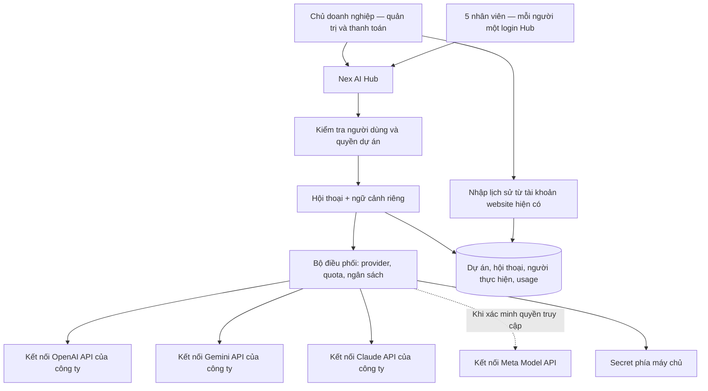

# Nex AI Hub — Kiến trúc cho chủ doanh nghiệp và 5 nhân viên

Ngày: 02/11/2026. Phiên bản: 0.2, cập nhật sau lựa chọn của người dùng. Trạng thái: **Đã chọn API tập trung và quyền Owner xem toàn bộ dự án công việc; thiết kế chi tiết còn là đề xuất, ngân sách cụ thể chưa chốt**.

Bản này thay thế các giả định về người dùng, tài khoản và phạm vi MVP ở [v0.1](architecture-v0.1.md). Thiết kế chuẩn hóa dữ liệu, import, bảo mật, backup và xử lý lỗi trong v0.1 tiếp tục là cơ sở nếu không có thay đổi được ghi tại đây.

## 1. Yêu cầu đã được làm rõ

- Một chủ doanh nghiệp và 5 nhân viên: thiết kế ban đầu cho 6 danh tính Hub riêng biệt.
- Chủ doanh nghiệp sở hữu/quản lý một tài khoản mỗi nền tảng: ChatGPT Plus, Gemini Pro, Claude Pro và Meta AI free. Tên “Gemini Pro” được ghi theo người dùng; cần xem tên gói chính xác khi kiểm tra quyền lợi.
- Nhân viên chỉ đăng nhập Nex AI Hub. Không tạo tài khoản hoặc mua thuê bao riêng ở từng nền tảng cho nhân viên.
- Mong muốn ban đầu là chủ doanh nghiệp đăng nhập các tài khoản trên vào Hub, nhân viên dùng các tài khoản đó qua Hub.
- Cần dự án riêng theo nhân viên, lưu và tìm lại trao đổi tập trung; vẫn giữ nhu cầu nhập dữ liệu từ website/app hiện có.
- Người dùng ưu tiên nhân viên chỉ dùng Hub và đồng ý xem xét ngân sách API tập trung. Lấy API làm hướng kiến trúc chính; chưa có hạn mức tiền, quyết định mua dịch vụ hoặc thiết bị sử dụng.
- Người dùng đã chọn: chủ doanh nghiệp (Owner) xem toàn bộ dự án công việc; nhân viên chỉ thấy dự án của mình và dự án được chia sẻ. Đây là chính sách nội dung trong workspace công ty.

“Meta AI free” là tình trạng tài khoản được người dùng cung cấp, không phải kết luận rằng Meta không có bất kỳ sản phẩm trả phí nào trên toàn cầu.

## 2. Đánh giá khả thi của cách cấp quyền

Cần phân biệt hai yêu cầu: **một đầu mối quản lý và thanh toán AI** với **dùng hạn mức của một thuê bao cá nhân cho nhiều người**. Kiến trúc API đáp ứng yêu cầu thứ nhất. Chưa có phương án tích hợp được hỗ trợ cho toàn bộ bốn nền tảng đáp ứng yêu cầu thứ hai bằng các gói đã nêu.

| Nền tảng | Tài liệu chính thức cho biết | Tác động lên kiến trúc |
|---|---|---|
| ChatGPT Plus | Tài khoản dành cho cá nhân; không được cung cấp tài khoản cho người khác. API tính phí riêng. Một số ứng dụng tham gia có thể dùng allowance qua Sign in with ChatGPT nhưng không tạo quyền chia sẻ tài khoản [S1][S2] | Không coi đăng nhập Plus một lần là quyền cung cấp ChatGPT cho 5 nhân viên |
| Claude Pro | Điều khoản cá nhân không cho cung cấp tài khoản cho người khác. Hướng dẫn ứng dụng phục vụ người khác yêu cầu dùng API; billing API riêng [S3][S4][S5] | Pro chưa phải kết nối backend dùng chung cho nhân viên |
| Gemini Pro | Google có chia sẻ quyền lợi gia đình trong phạm vi hỗ trợ, nhưng thành viên dùng Google Account của mình. Gemini API sử dụng project và billing riêng [S6][S7] | Không suy ra quyền vận hành Hub nhiều người từ một phiên đăng nhập Gemini cá nhân; family sharing không đáp ứng yêu cầu nhân viên chỉ có tài khoản Hub |
| Meta AI free | Model API có cơ chế API key riêng [S8] | Tài khoản Meta AI free không tự chứng minh có quyền API, hạn mức API miễn phí hoặc quyền phân phối phiên đăng nhập cho nhân viên |

Đánh giá này không nói rằng tạo một lớp proxy trình duyệt là bất khả thi về kỹ thuật. Tuy nhiên, proxy không thay đổi quyền sử dụng tài khoản. Nó còn phụ thuộc phiên đăng nhập/OTP, giao diện thay đổi, quota chung và trạng thái/memory ở tài khoản nguồn. Phân quyền ở Hub không thể tự bảo đảm cô lập dữ liệu bên trong một phiên website dùng chung. Đây là suy luận kiến trúc, không phải kết quả thử nghiệm trên tài khoản của người dùng.

Không lấy session/cookie của thuê bao cá nhân làm nền tảng triển khai đa người dùng. Nếu một nhà cung cấp có cơ chế ủy quyền chính thức dành đúng trường hợp này, cần xác minh riêng trước khi thêm adapter.

## 3. Hướng kiến trúc đã chọn: kết nối API tập trung

Chủ doanh nghiệp quản lý một tổ chức/project thanh toán API thích hợp ở mỗi nhà cung cấp. Backend Hub giữ credential của ứng dụng. Nhân viên không cần tài khoản nhà cung cấp hoặc API key riêng để sử dụng giao diện Hub.

OpenAI cho phép dùng API trong ứng dụng phục vụ end users; Anthropic có cơ chế tương ứng trong điều khoản thương mại [S9][S10]. Google hướng dẫn API key gắn project [S11]. Với Meta, cần xác minh quyền truy cập thực tế trước khi ghi “đã tích hợp”.

**Người dùng đã chọn ưu tiên nhân viên chỉ dùng Hub và có thể xem xét ngân sách API tập trung.** Điều này xác định hướng thiết kế; không phải phê duyệt một mức chi hoặc mua dịch vụ. Hạn mức Plus/Pro hiện có không được mặc định chuyển thành ngân sách API. Chưa có bằng chứng API sẽ rẻ hơn tổng phí hiện tại; phải đo usage thực tế.

Một kết nối logic không bắt buộc chỉ có một API key mãi mãi: có thể tách key theo môi trường hoặc thay khóa. Điều giữ nguyên là công ty quản lý credential, nhân viên chỉ có danh tính Hub.

Ví dụ: A mở dự án nghiên cứu, B mở dự án nội dung. Cả hai dùng cùng kết nối Claude API của công ty; mỗi request có ngữ cảnh và chủ sở hữu riêng. Hub ghi người dùng, dự án và usage trước/sau mỗi lượt, thay vì dựa vào danh tính tài khoản Claude để phân biệt nhân viên.

## 4. Phạm vi MVP được thu gọn

| Module | Cần cho 6 người dùng Hub | Lược bỏ hoặc hoãn |
|---|---|---|
| Người dùng | Owner và Employee; mời/khóa, thu hồi phiên | Vai trò Admin ủy quyền riêng, nhiều doanh nghiệp, SCIM, cấu trúc phòng ban phức tạp |
| Tài khoản nhà cung cấp | Bốn bản ghi tài khoản hiện có, người quản lý, loại gói, ngày gia hạn/kiểm tra | Mua/cấp seat nhà cung cấp cho từng nhân viên |
| Kết nối chung | Credential phía server, trạng thái, model, quyền dùng theo người | Cho nhân viên tự mang key hoặc tự cấu hình provider |
| Dự án | Owner xem toàn bộ; nhân viên thấy dự án mình sở hữu/được chia sẻ; quyền đọc/đóng góp tách riêng | Hệ thống quản lý công việc đầy đủ |
| Hội thoại | Chọn model, lưu tự động, nhánh khi đổi AI, tìm kiếm | Tự động cho nhiều AI tranh luận, agent tự hành |
| Chi phí | Tổng công ty, theo người/dự án/provider, giới hạn và cảnh báo | Hóa đơn thu lại tiền từng nhân viên |
| Lịch sử bên ngoài | Chủ tài khoản nhập export, chọn hội thoại và gán dự án | Compliance API Enterprise vì các gói hiện tại chưa đủ điều kiện đã xác minh |

Meta có thể có mặt trong danh mục và kho nội dung nhập ngay cả khi chat API chưa sẵn sàng. Phải phân biệt “đã quản lý tài khoản” với “đã chat được” và “đã đồng bộ được”.

## 5. Những thay đổi trong mô hình dữ liệu và xử lý

- `Workspace`: một công ty; chưa xây tính năng SaaS đa khách hàng.
- `User`: 6 danh tính dự kiến. `Project` + `ProjectMember` quản lý dữ liệu riêng và chia sẻ.
- `ProviderAccount` + `Subscription`: tài khoản/gói do chủ doanh nghiệp quản lý. `SeatAssignment` không cần trong MVP.
- `ProviderConnection` + `ConnectionGrant`: một kết nối logic dùng bởi nhiều nhân viên; quyền sử dụng tách khỏi quyền quản trị secret.
- `Conversation` + `Message` + `Run`: mỗi lượt có `actor_user_id`, `project_id`, `conversation_id`, `connection_id`, model và trạng thái.
- `UsageRecord` + `Budget`: ngân sách chung và từng người; không giả định quota riêng theo login Hub.
- `ImportBatch` + `SourceRecord`: dữ liệu website cũ chưa biết ai tạo không được tự gán cho nhân viên. Lưu người nhập và người được giao phụ trách thành hai trường khác nhau.

Backend suy ra người dùng từ phiên đã xác thực; không tin `user_id` do trình duyệt tự gửi. Kiểm tra quyền dự án trên mọi lần đọc, tìm kiếm, xuất tệp và gọi AI.

Quyền đọc dự án được cấp khi người dùng đang hoạt động, thuộc workspace của dự án và là Owner của workspace, chủ dự án hoặc thành viên được chia sẻ. Owner không cần được thêm thủ công vào từng dự án. Bộ lọc workspace luôn được áp dụng, kể cả với Owner. Quyền đọc bao phủ danh sách, nội dung hội thoại, tìm kiếm, trích dẫn và tệp; thiết kế đề xuất cho tải/xuất cùng phạm vi đọc. Quyền sửa, gửi prompt hoặc chia sẻ lại theo quyền quản lý/đóng góp của dự án, không phát sinh chỉ vì có quyền xem toàn bộ.

Giao diện thông báo “Dự án công việc — chủ doanh nghiệp có quyền xem nội dung”. Ghi audit cho thao tác xem nội dung, tải/xuất và thay đổi quyền, gồm người thực hiện, hành động, tài nguyên và thời điểm. Việc có thể xem nhiều dự án không tự đưa nội dung các dự án đó vào ngữ cảnh AI.

Mỗi conversation có vùng ngữ cảnh riêng. Nếu provider lưu state từ xa, remote thread/file/vector-store ID được ánh xạ tới đúng phạm vi nội bộ; không dùng một remote thread cho mọi nhân viên. Khi dùng chung project/API key, quyền nội bộ vẫn phải kiểm tra tại Hub, vì credential có thể đọc nhiều tài nguyên phía provider.

Giới hạn request được đặt cả theo người và theo provider. Cho phép song song nếu quota thực tế đáp ứng; tuần tự hóa các lượt trong cùng conversation để tránh sai thứ tự. Khi thiếu quota, hàng đợi công bằng và hiển thị trạng thái chờ. Không tạo thêm quota bằng cách tạo thêm login Hub.

Giữ trước chi phí dự toán trong giao dịch, giới hạn output rồi đối soát usage; chi phí chưa biết được ghi rõ. Lỗi/timeout không tự gửi lại mù hoặc đổi provider âm thầm. Tổng mức thanh toán thực tế còn phụ thuộc thời điểm báo usage và cơ chế billing của nhà cung cấp.

## 6. Vận hành và tiêu chí hoàn thành

Giữ backend modular monolith, PostgreSQL, kho tệp riêng tư và một worker nền. Chưa cần microservices hay hạ tầng nhiều vùng cho 6 tài khoản. Không suy ra cấu hình máy từ số tài khoản: cần đo số lượt đồng thời, độ dài hội thoại, tệp và công cụ AI sử dụng.

Kiểm chứng tối đa 6 phiên Hub cùng hoạt động; số request AI đồng thời chốt sau khi biết quota thực tế. Giữ mục tiêu thử nghiệm p95 dưới 1 giây cho thao tác kho dữ liệu trên tập pilot đã thống nhất; thời gian provider tách riêng. RPO/RTO trong v0.1 vẫn là đề xuất cần xác nhận, chưa phải SLA.

Các tiêu chí nghiệm thu chính:

1. Nhân viên đăng nhập và chat trong Hub mà không đăng nhập website nhà cung cấp, khi kết nối API đã được cấu hình hợp lệ.
2. Hai nhân viên dùng cùng kết nối nhưng không nhận ngữ cảnh/tệp của nhau nếu chưa được cấp quyền.
3. Không có API key/cookie nhà cung cấp trong trình duyệt nhân viên.
4. Mỗi lượt xác định được người thực hiện, dự án, provider và chi phí thực tế/ước tính/chưa biết.
5. Khóa một nhân viên ngăn request mới và thu hồi phiên Hub; không phải đổi khóa API chung nếu khóa chưa bị lộ.
6. Quota provider cạn thì mọi người thấy trạng thái phù hợp; prompt đã lưu không mất.
7. Lịch sử nhập không đủ thông tin tác giả phải hiển thị chưa xác định, thay vì tạo attribution giả.
8. Owner xem và tìm được nội dung mọi dự án công việc trong workspace mà không cần lời mời; nhân viên không thấy nội dung, tiêu đề, đoạn trích hoặc tệp của dự án ngoài quyền.
9. Thu hồi chia sẻ làm mất quyền truy cập ở các request mới và job chờ; kiểm tra lại quyền trước khi tạo đường dẫn tải/xuất. Quyền xem toàn bộ của Owner không cho phép tự động sửa/gửi prompt vào dự án người khác.

Chưa có phần mềm hoặc tài khoản API được kết nối trong lần phân tích này; các mục trên là tiêu chí triển khai sau này.

## 7. Lựa chọn hiện tại và quyết định còn mở

| Phương án | Đạt được | Phần chưa đáp ứng |
|---|---|---|
| API tập trung — hướng được chọn | 5 nhân viên chỉ login Hub; một đầu mối quản lý và thanh toán; dữ liệu riêng theo người/dự án | Ngân sách còn mở; không dùng chung mặc định hạn mức Plus/Pro |
| Chỉ quản lý/import, chưa gọi API — phương án tham khảo | Lưu tài khoản, dự án, nhập/tìm kiếm nội dung | Không phải hướng sản phẩm chính đã chọn; thiếu luồng chat trực tiếp cho nhân viên |

Tiếp tục đặc tả MVP theo API tập trung; xem [phạm vi MVP và kiểm soát chi phí](mvp-scope.md). Chưa đánh dấu R09 đã triển khai hoặc tự mua API/đổi/hủy gói. Ngân sách pilot và production sẽ chốt bằng mức chi được người dùng chọn cùng dữ liệu sử dụng thực tế. Nhu cầu đồng bộ bên ngoài vẫn giữ, nhưng lịch sử dùng chung không có đủ dấu vết để tự xác định tác giả từng nhân viên.

Quyền Owner xem toàn bộ dự án công việc đã được người dùng xác nhận. MVP dùng hai vai trò Owner và Employee; nếu có thêm quản trị kỹ thuật được ủy quyền về sau, quyền đọc toàn bộ không tự gắn với vai trò đó. Mức ngân sách pilot và tính năng AI ưu tiên tiếp tục là đầu vào cần chốt.

## 8. Truy vết cập nhật và quyết định kiến trúc

- R02 cụ thể hóa thành 1 chủ doanh nghiệp + 5 nhân viên.
- R04 cụ thể hóa thành 1 tài khoản mỗi nền tảng do chủ doanh nghiệp quản lý; bỏ cấp seat cá nhân khỏi MVP.
- R05 chọn hướng kết nối tập trung; mức ngân sách API cụ thể chưa được chấp thuận.
- **R09 mới:** Nhân viên chỉ cần login Hub, không cần tài khoản nhà cung cấp. Phương án API có thể đáp ứng sau triển khai/kiểm chứng; mong muốn dùng nguyên các thuê bao cá nhân làm nguồn truy cập chung hiện chưa có phương án được hỗ trợ cho cả bốn nguồn.
- R01, R03, R06–R08 giữ nguyên, nhưng mức hỗ trợ của từng nguồn phải công bố trung thực.
- **R10 mới, đã xác nhận:** Owner xem toàn bộ dự án công việc; Employee chỉ thấy dự án sở hữu hoặc được chia sẻ. Việc triển khai và nghiệm thu R10 chưa diễn ra.

Xem [ADR-008 đến ADR-011](decision-records.md) để biết lựa chọn và đánh đổi. Hướng kiến trúc ở ADR-008 và chính sách quyền xem ở ADR-011 đã được chọn; không suy ra người dùng đã duyệt toàn bộ chi tiết khác.

## 9. Nguồn chính thức, kiểm tra ngày 02/11/2026

- [S1 — OpenAI Account Sharing Policy](https://help.openai.com/en/articles/10471989-openai-account-sharing-policy)
- [S2 — ChatGPT Plus: API và participating tools](https://help.openai.com/en/articles/6950777-what-is-chatgpt-plus)
- [S3 — Anthropic Consumer Terms, Account creation and access](https://www.anthropic.com/legal/consumer-terms)
- [S4 — Claude: Log in, guidance for developers](https://support.claude.com/en/articles/13189465-log-in-to-your-claude-account)
- [S5 — Claude: API billing separate from paid plan](https://support.claude.com/en/articles/9876003-why-is-claude-api-usage-billed-separately-from-my-paid-claude-plan)
- [S6 — Google One: Family sharing](https://support.google.com/googleone/answer/9004015?hl=en)
- [S7 — Gemini API billing](https://ai.google.dev/gemini-api/docs/billing/)
- [S8 — Meta Model API authentication](https://dev.meta.ai/docs/authentication)
- [S9 — OpenAI Services Agreement, section 2.2](https://openai.com/policies/services-agreement/)
- [S10 — Anthropic Commercial Terms, section A.1](https://www.anthropic.com/legal/commercial-terms)
- [S11 — Gemini API keys and projects](https://ai.google.dev/gemini-api/docs/api-key)
